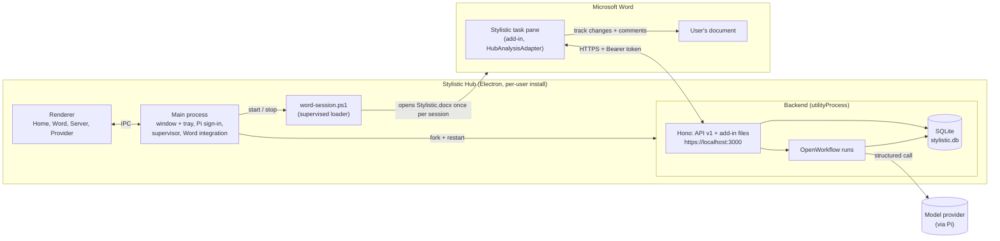
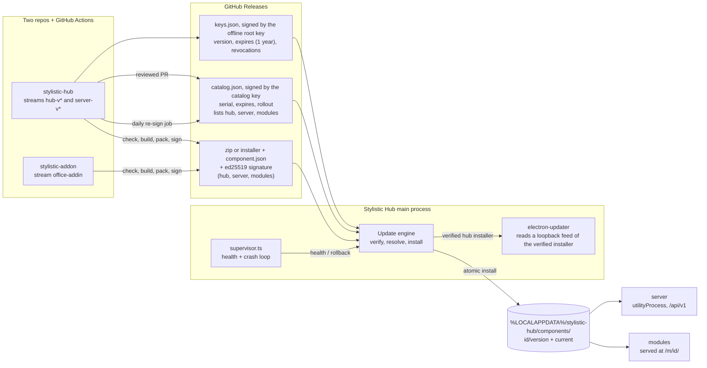
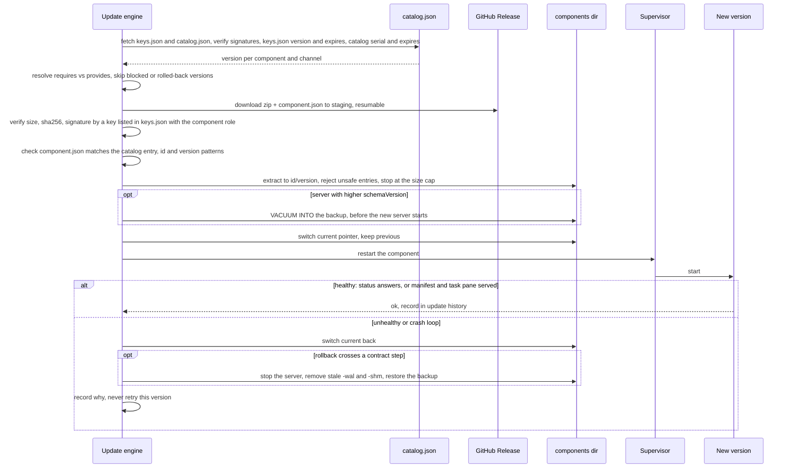

# Architecture

Stylistic is a Word add-in that suggests editorial changes as Word track changes, and the Stylistic Hub is the Windows desktop app that makes it run on one computer: it installs the add-in into Word, serves it, and runs the local backend that analyzes the text with the model provider the user signed in to. This page first describes the product as a whole, then the backend's internal design. Where the next steps are going: [roadmap](roadmap.md).

## System overview



### Components

| Component | Where | What it does |
|---|---|---|
| Main process | `src/main/app.ts` | Owns the window and the tray (closing the window keeps the hub running), the IPC for the screens, and the per-user state under Electron's `userData` (`src/main/hub-paths.ts`: Pi folder, `stylistic.db`, certificates, hub token). |
| Renderer | `src/renderer/` | React + Fluent UI v9 screens: Home (the next undone step), Word add-in, Local server, AI provider. |
| Provider sign-in | `src/main/pi-provider.ts` | Pi owns the provider catalog, OAuth and API-key sign-in, credentials and the chosen model; the hub only sees the `PiProvider` port. The backend reads the same Pi folder. |
| Supervisor | `src/main/supervisor.ts`, `src/main/backend-host.ts`, `src/main/server-switch.ts`, `src/main/module-switch.ts` | Forks the backend as an Electron `utilityProcess` and restarts it with backoff, from the current server component or the built-in backend, with the installed modules in `STYLISTIC_MODULES`; rolls a failing server component or module version back. The Word loader reuses the supervisor. |
| Backend | `src/backend/entry.ts` | One HTTPS server on `localhost:3000` with a certificate from its own local CA (name-constrained to `localhost`, `127.0.0.1`, `::1`): [API v1](api.md) for the add-in, and the add-in's own files with the hub token written into `taskpane.html` ([add-in contract](addin-contract.md)), at the root from `--addin` and at `/m/<id>/` for each module named by `STYLISTIC_MODULES`. Loopback only, Host-header guard, bearer token: the hub token (the root add-in's, and the main process's for health checks) reaches every route; each module's task pane gets its own token, HMAC-SHA256 of `module:<id>` keyed by the hub token, derived by the backend and limited to the [API scopes](api.md#scopes) the module declared (`src/backend/adapters/http/module-tokens.ts`). |
| Workflows and storage | `src/backend/analysis/`, `feedback/`, `profile/` | Analyses and feedback run as durable OpenWorkflow runs on SQLite, so they survive a hub restart; the API reads its own SQLite read model, not the engine's tables. |
| Word integration | `src/main/word-integration.ts` | Trusts the local CA for the current user (`certutil -user -addstore Root`) and registers the add-in manifest in Word's sideload list (`HKCU\…\Wef\Developer`): the stable manifest `components/<id>/manifest.xml` of each downloaded module, and nothing else. While Stylistic is in Word, a module manifest is registered again only when its sha256 differs from the one kept in `components/<id>.registered.sha256` (beside the component folder, because an install prunes everything else inside it). With no module served, only entries whose file is gone are removed (an uninstalled module, the bundle an earlier hub shipped); a live registration is left alone. The legacy bundled path is never registered from, only recognized so an earlier hub's entry is removed, not kept (odd/tasks/catalog-only-word.md S1). |
| Word session loader | `src/main/word-session.ts`, `resources/word/word-session.ps1` | Registering is not enough: Word loads a sideloaded add-in only while it shows a document that refers to it. The hub waits for module resolution and registration sync before restoring the loader and Windows startup setting, and checks again after module readiness changes; an unresolved module set must not disable automatic loading. Once per Word session, after the user opens a document, the loader opens `Stylistic.docx` (the trigger document) through COM, waits for the add-in's UI, closes the trigger and its pane, and gives the user's window back. The trigger is staged by `bun scripts/stage-word.ts` into the installed hub's `word/` directory with the production add-in id, outside any content bundle, so the same trigger loads the downloaded module. The trigger is visible for about a second (see the custom-code table below). |
| Add-in | separate repository `stylistic-addon` | The task pane in Word. In hub mode it reads the token from `<meta name="stylistic-hub-token">`, talks to API v1 through `HubAnalysisAdapter`, `HubFeedbackAdapter` and `HubUserCorrectionPreferencesAdapter`, and writes suggestions into the document with Word's track changes and comments. The hub downloads it as the `stylistic-word-addin` module from the signed catalog (Home and Word install it through the Library screen); `bun run addin:bundle` still builds a checkout for development against [the add-in contract](addin-contract.md). |
| Installer | `electron-builder.yml`, `scripts/stage-word.ts` | `bun run dist` builds an unsigned per-user NSIS installer carrying the hub only: no add-in is packed, even when a stale `out/addin` sits in the tree. The installer's `word/` directory holds the session loader plus its trigger document, staged with the production add-in id. |

### From "Analizar y sugerir" to track changes

1. **Before:** the user installed the hub, signed in to a provider and chose a model, and turned on Stylistic in Word from the hub; the hub trusted its CA, registered the manifest and started the loader, which loads the add-in into each Word session.
2. **Ready check:** the task pane asks `GET /api/v1/status`; until a model is chosen it shows the hub's `reason` instead of analyzing.
3. **Start:** on "Analizar y sugerir" the add-in splits the selection or document into chunks at paragraph ends and sends `POST /api/v1/documents/{documentId}/analyses` with the genre; `documentId` is the UUID the add-in keeps in the Word document. The hub answers `202`.
4. **Run:** an OpenWorkflow run splits each chunk into parts that fit one model call, analyzes the parts in parallel as child workflows (each a forced structured call through Pi to the chosen provider), drops suggestions whose anchor is not in their context, stores the rest in the read model, and updates the document's style profile once.
5. **Poll:** the add-in polls `GET /api/v1/analyses/{id}` until the analysis is `completed`, `partial`, `failed` or `canceled`; a provider's error arrives in the failed chunk's `error`, not as an HTTP error.
6. **Apply:** the task pane locates each suggestion's anchor in the document and applies it as a track change or a comment, which the user then accepts or rejects.
7. **Learn:** each accept or reject is sent to `POST /api/v1/feedback`, which updates the profile in the background for the next analysis.

The request and response shapes live in [API v1](api.md); what an add-in build must provide lives in the [add-in contract](addin-contract.md).

## Target architecture: component delivery

> **Target, not today's behaviour.** This section describes where delivery is going; the System overview above is what runs today. The decision and its alternatives: [ADR 0001](adr/0001-component-delivery.md). The milestones that build it: [roadmap](roadmap.md).

The hub becomes a launcher: installed once, it installs and updates its components independently, like HoYoPlay does with its games. The hub, the server and every module are versioned, released and updated on their own.



### Current vs target

| Aspect | Today | Target |
|---|---|---|
| What the installer carries | Hub, backend and one add-in build (`bun run dist`) | The hub and its built-in backend only (S1); the Word module downloads on request (S5 keeps the built-in backend) |
| Where the add-in comes from | A sibling checkout built by `bun run addin:bundle` into `resources/addin/` | A signed release of the module's own repo, downloaded by the hub (D2, D5); `addin:bundle` stays for development only |
| Where the server comes from | `components/server/<current>/entry.js` when a server component is installed, not marked bad and has that file, else the built-in backend (`src/backend/entry.ts`, transitional until M5); `--server <dir>` forks `<dir>/entry.js` in an unpackaged hub. `server-switch.ts` decides, `backend-host.ts` forks with the same arguments for every entry, and a catalog check that installs a new version moves the backend to it | A signed `server-v*` release under `components/server/<version>/`, forked the same way (D1, D5) |
| Updating the add-in or the server | Rebuild and reinstall the hub | Per component, from the catalog, without touching the hub (D5) |
| Updating the hub | Manual reinstall | The hub is a catalog component: the engine verifies its installer (sha512 and our signature), then serves that file from a loopback feed and electron-updater installs it; channels `stable`/`beta` (D10) |
| Integrity | None beyond the installer itself | ed25519 signatures over `component.json`; catalog signed by an online key with `serial` and `expires`; online keys vouched for, and revoked, by a versioned, expiring `keys.json` signed by an offline root key (D3, D4) |
| Compatibility | Implicit: whatever was bundled together | `requires`/`provides` ranges resolved before install (D2, D5) |
| Failure of a new version | After a start from a component, `/api/v1/status` must answer 200 within 30 s (`health-check.ts`); a failed check, or 3 exits of runs that never reached a minute (`supervisor.ts`), marks the version bad and goes back to `previous`, or to the built-in backend when there is none; the reason is in the update history and on the Server screen (state `rolled-back`). The built-in backend and `--server` keep restarting with backoff, with the reason shown | Health check or crash loop rolls back to the previous version (D6) |
| Database across versions | `user_version` migrations, each `expand` or `contract`; `schema_meta.min_reader_schema` is the lowest schema that reads the database (backfilled as `user_version` on a 0.0.1 one), and a newer database opens when the backend's `SCHEMA_VERSION` is at least that value; before migrating an existing database, `VACUUM INTO backups/stylistic-schema<from>-<UTC yyyymmddHHMMss>.db` beside it (`database.ts`). On rollback the hub reads the database's `minReaderSchema` with `src/shared/schema-state.ts` | Expand/contract migrations with the database's `minReaderSchema`: an older server whose `schemaVersion` is at least that value opens a newer database it can still read, so an expand-step rollback needs no restore; a `VACUUM INTO` backup is restored only after a contract step (D7). This changes `database.ts` |
| Add-in URL | `https://localhost:3000/` root | `https://localhost:3000/m/<id>/` per module (D8) |
| Word registration | Manifest registered once by `word-integration.ts` | The manifest lives at a stable path (`components/<id>/manifest.xml`) and is re-registered whenever its content hash changes; the M5 hub (delivered by self-update) moves the add-in from the 0.0.1 root URL to `/m/<id>/` and removes the root-URL entry (D8) |
| Rollback of data | `server-switch.ts`: when the database's `minReaderSchema` is above the previous version's `provides.schemaVersion`, the stopped server's database is replaced by the newest readable backup taken at exactly that schema (else the newest at the highest older schema), `-wal`/`-shm` removed, and the history and Server screen name the restored backup and say the writes since it was taken were lost; with no such backup the downgrade is refused and the server stays stopped | Expand step: no restore, no lost writes. Contract step: restore the pre-upgrade backup; writes since the upgrade are lost and the hub says so (D7) |
| Stale or expired catalog | Not applicable | Installed components keep running, offline too; updates pause and the hub shows the reason (D4) |
| Where state lives | `userData` for settings and logs | Large binaries in `%LOCALAPPDATA%` (off the roaming profile); state, backups and the last-seen `serial` stay in `userData` (D5, D7) |
| API token | One hub token written into `taskpane.html` | Module-scoped tokens limited to the API scopes the module declares (quality bar) |

### Install, update and rollback



A failure at any step before the pointer switch leaves the installed version untouched; the staging area is discarded or resumed on the next check. A rollback after an expand step restores nothing: the previous server opens the same database.

**The hub itself** (S4, `src/main/updates/self-update.ts`, `feed.ts`) takes the same path up to the download and stops there. After each verified catalog check, the `stylistic-hub` entry of kind `hub` offered on the hub's channel (see below) whose version is newer than the running hub's is fetched like any component: binding check, `component.json` signed by a key with scope `stylistic-hub` (whatever publisher the entry names), the installer downloaded (resumable) to `components/stylistic-hub/.staging/stylistic-hub-<version>.exe` and its sha256 and size checked. Nothing is extracted and `state.json` does not record the hub. A `node:http` server on `127.0.0.1` and a random port then serves exactly `/latest.yml` and that file (anything else is a 404); it refuses to start unless the file on disk still matches the signed sha256 and size, and the `sha512` in `latest.yml` is computed from those same bytes. electron-updater's generic provider reads that feed, downloads the installer, rejects it unless its sha512 matches, and installs it when the hub quits (`self-update-electron.ts`, with differential and web-installer downloads off and its own `app-update.yml` under `components/stylistic-hub/`). A failed electron-updater run closes the feed and is retried at the next check.

**Channels, rollout and pulled versions** (M6, `src/main/updates/channels.ts`, odd/tasks/channels.md). `state.json` holds a `channel` (`stable` or `beta`) per component, the hub's own under `hub.channel`, and a random `installId` created at the first check; a missing field reads as `stable`, so an M4 state file reads unchanged. A catalog entry is offered to this install when its `channel` is the component's channel (a `beta` channel also takes `stable` entries, so it is never behind stable: odd/tasks/catalog-auto-update.md S1), its `version` is not in its own `blocked` list, and it is in the rollout: `rolloutPercent` is 100, or the first 4 bytes of `sha256(installId:id:version)`, read as a big-endian unsigned integer, modulo 100 are below it. Of the versions offered for a component, the engine, the self-update and the Library take the newest (a release sorts after its betas), whatever the catalog order, and the engine skips one marked bad on this install. On `beta` the engine installs only a newer version, so a bad newest beta or a stable outside the rollout never sends an install back to an older one. On `stable` it installs that version even when it is older than the running one, so switching back to `stable` installs the latest stable (a downgrade), with one exception for the server: when the new server's `provides.schemaVersion` is below the database's `minReaderSchema` (read with `readSchemaState`), the install fails before the download with the reason `stays on <current> until <channel> reads this database`, nothing is restored, and the Server screen shows that reason; this guard applies to every server install, not only after a switch. The hub's self-update takes the same offered entry and installs an older one, with electron-updater's `allowDowngrade`, only when the user has chosen `stable` and the running hub is a `-beta.N` version; a switch to `beta` never downgrades. An installed version that is later blocked keeps running until the catalog offers another version. The Server screen chooses the server's and the hub's channel; a change runs a catalog check at once (or right after the one running).

**Modules on request** (M5, `src/main/updates/engine.ts`, odd/tasks/module-library.md S2). The engine installs the server and updates what is installed; a module is installed the first time only on request: `requestInstall(id)` writes an empty entry (`current: null`) for it in `state.json`, and the next catalog check installs the version its channel offers, with the same rollout, blocked and bad-version rules as any installed component. `uninstall(id)` removes the module's entry, adds a `disabled` history line with the reason `uninstalled` (no new outcome value: older hubs, which a channel switch can install, read `state.json` with a fixed list of outcomes), and deletes `components/<id>/`; both refuse the server, the hub and anything that is not a component id. Before the download of any component other than the server, every API in its `requires.api` must be in the current server's `provides.api` (the installed server's verified `component.json`, or `v1`, what the built-in backend serves, when no server component is installed); otherwise the install fails with the reason `requires api <list>`. The provider-side check stays: a server that drops an API an installed module requires is refused with `incompatible: <id> requires api <list>`. A module's `component.json` must be signed by a key whose scope is the catalog entry's `publisher` (`stylistic-addon` for the add-in, docs/keys.md), else `wrong_scope`.

**Module switch** (M5, `src/main/module-switch.ts`, odd/tasks/module-library.md S3). The current version of each installed `office-addin` module that is not marked bad and whose `manifest.xml` names a `<Version>` reaches the backend through `STYLISTIC_MODULES`: its directory `components/<id>/<current>` and the scopes of its verified `component.json` `requires.scopes` that the backend knows (none when it declares none; an unknown scope is left out, as the backend would drop it with a log line). `backend-host.ts` sets the variable at the next spawn, and the backend restarts only when that set changes, after a catalog check, before the server switch's own refresh. Whenever a module version enters the set (at hub start too), `components/<id>/manifest.xml` is copied from it and, once the server answers its own health check, `/m/<id>/manifest.xml` and `/m/<id>/taskpane.html` must both answer 200 within 30 s (main-process requests with the hub token). A failure marks the version bad (`health_check_failed` in the history), goes back to `previous` (a `switched` line) or, with none, stops serving the module, and the Server screen's reason says which; a late result of a replaced version is ignored. No verdict is given while the server itself is down. An older server component ignores the variable and serves no `/m/`, so a module under it fails its check and rolls back: a module needs a server with module serving (S1), and there is no version negotiation.

**Library screen** (M5, `src/main/library.ts`, `src/renderer/library/`, odd/tasks/module-library.md S5). One card per component: the server, the hub and every module in `state.json` or in the last verified catalog, with the installed version (the hub's from `app.getVersion()`), its channel, the version that catalog offers this install on that channel (`offered`: rollout and pulled versions apply), and its last five history lines. The last verified catalog is kept in memory by `createLibrary` from each check's report (`onChecked`), so `available` is unknown until a check succeeds after the hub opens; each check also tells the renderer to read the library again (`hub:library-checked`). Actions are the ones the engine has: Install for a module (`requestInstall`, then a catalog check), Uninstall for a module in the state (also cancels a request), the channel of the server, the hub or a module in the state through the Server screen's `hub:server:set-channel` (a module not in the state is refused, as setting its channel would request it), and Check now, which reads Checking… until the check ends; the page then says when the last check ended and why it failed (`checking`, `lastCheck`). The hub card shows where the hub's own update stands (`SelfUpdate.status`, announced through `onStatus` as it changes): up to date, downloading and verifying a version, failed with the reason (the next check tries again), or ready, with Restart and update to that version (`hub:library:restart`: `quitAndInstall` silent, then the installer starts the hub again); the tray menu offers the same restart. The hub lives in the tray and seldom quits, so without it the update would wait for the next sign-in. Each check and each hub update step is also appended to `update.log` in the logs folder. No roll back or repair yet. While no server component is installed, the screen says the server is being downloaded (each check installs it) and the catalog's modules carry Install.

### Design decisions

- **D1 Components.** Three kinds, each with its own release stream and tags: `hub` (Electron shell, `hub-v*`), `server` (the backend bundle, `server-v*`, run by the hub in its `utilityProcess`), `module` (an `id` and a `kind`; the first kind is `office-addin`, the Word add-in; the kind leaves room for others without designing them now). Two repos today: `stylistic-hub` publishes the `hub` and `server` streams, `stylistic-addon` publishes the `office-addin` stream; a future module may live in its own repo. The streams, not the repos, are per component.
- **D2 Release artifact.** Every server and module release publishes a zip plus a `component.json`: `id`, `kind`, `version`, `channel`, `sha256`, `size`, `requires` (a `hub` range and, for modules, the server `api` range such as `^1`), `provides` (for the server: the API versions it serves and its SQLite `schemaVersion` and the `minReaderSchema` its migrations set), the uncompressed size cap that extraction enforces (D5), and a release notes URL. They are GitHub Release assets of the component's own repo.
- **D3 Own signing, no CA.** ed25519 detached signatures, in two tiers of keys. An offline **root key** (kept off CI, used rarely) signs a `keys.json` that lists the online keys and their roles; an online **catalog key** in CI signs `catalog.json`; online **component keys** sign each `component.json`, which pins the zip's sha256. The hub embeds only the root public key, plus the next root public key one release ahead. `keys.json` carries a monotonically increasing `version` and an `expires` of 13 months (the root key re-signs it every year in an offline ceremony, so a late ceremony has a month of margin; the hub warns 30 days before expiry). The hub stores the last-seen `version` beside the catalog `serial` and rejects a lower one or an expired list, so a retired key cannot replay an old `keys.json`. Like an expired catalog, an expired `keys.json` only blocks updates: installed versions keep running and are not disabled, because disabling needs a valid list that revokes their key. A catalog is accepted only if signed by a key that the current `keys.json` lists with the catalog role, a component only if signed by a key listed with the component role. **Rotation:** online keys rotate with no new hub, because the root key signs a new `keys.json`; only a root rotation ships in a hub. **Revocation:** it lives in `keys.json`, not in the catalog: revoking a compromised online key is a new root-signed `keys.json` without it, which the attacker cannot forge or roll back. It is enforced at every catalog check, not only at install: an installed version covered only by a revoked key is disabled and replaced by the catalog's current version.
- **D4 Signed catalog (TUF-lite).** The hub repo publishes a signed `catalog.json` listing, per component and channel, the current version and its artifact URLs. The hub itself is one of those components (D10). A monotonically increasing `serial` and an `expires` date let the hub reject rollback (an older serial) and freeze (an expired catalog) attacks. It has fields for staged rollout (`rolloutPercent`) and for blocking a bad version. **Freshness:** a scheduled CI job re-signs the catalog daily (new `serial`, `expires` = +14 days) even with no content change, so it never lapses unattended; a lapse of more than 14 days only blocks updates. An expired or older catalog never stops installed components: they keep running, offline too, and the hub shows the reason and retries. The last-seen `serial` (and the `keys.json` `version`) live in the hub's `userData`; a reinstall that loses them trusts the first valid, unexpired `keys.json` and catalog (accepted trust-on-first-use).
- **D5 Update engine.** In the hub's main process: checks on start and periodically; downloads into staging with resume; verifies size, sha256 and signature; checks the binding: before anything is extracted, the signed `component.json` must match the catalog entry (`id`, `kind`, `version`, `channel`, `sha256`) and `id` and `version` must match strict patterns; resolves compatibility (the hub range, the server API against each module's required range) and refuses an update set that would break another component; installs atomically into `%LOCALAPPDATA%/stylistic-hub/components/<id>/<version>/` with a `current` pointer; keeps the previous version. Extraction rejects absolute paths, `..`, symlinks and Windows reserved names, and stops at an uncompressed size cap declared in `component.json` (zip-slip guard). `%LOCALAPPDATA%` is deliberate (large binaries stay off the roaming profile); state, backups and the last-seen `serial` stay in `userData`.
- **D6 Health checks and automatic rollback.** After switching a server version the hub waits for `/api/v1/status`; after switching a module it checks that its manifest and task pane are served. A failure, or a crash loop detected by `supervisor.ts`, rolls back to the previous version and records why; the bad version is not retried until a newer one appears. Crash-loop detection is new work in `supervisor.ts` (today it backs off forever): N exits within a window before a stable run mark the version failed. A failed first install with no previous version leaves the component "not installed", with the reason and a retry, never a restart loop.
- **D7 Server data safety.** Migrations are forward-only and expand/contract: a release never drops what the previous release reads. `minReaderSchema` is a property of a database schema, recorded in the database by the migration that produced it: the lowest server `schemaVersion` that can still read this database. A server whose own `schemaVersion` is S opens a database at schema D > S only if S is at least that database's `minReaderSchema` (a change to `database.ts`, which today refuses any newer schema). An expand migration leaves `minReaderSchema` as it was, so a rollback opens the same database with no restore and no lost writes; a contract migration raises it to its own `schemaVersion`, and only then is the backup restored on rollback (writes since the upgrade are lost, and the hub says so). The backup is taken with `VACUUM INTO` (consistent while the server runs in WAL mode) into the `userData` backups folder before the new server starts; a restore stops the server and removes stale `-wal` and `-shm` files. Each server release declares in `component.json` the `schemaVersion` it writes and the `minReaderSchema` its migrations set. A downgrade is refused when the older server is below the database's `minReaderSchema` and no backup of a readable schema exists.
- **D8 Module serving and Word.** Each module is served at `/m/<id>/` on the hub origin, with the versioned asset URLs and `Cache-Control` the hub already applies (`bef61c1`). The registered manifest lives at a stable path (`components/<id>/manifest.xml`, rewritten on each version switch), never under a versioned folder. The hub re-registers with Word whenever that manifest's content hash changes (new ribbon commands, a new source location), not only its identity. A new version takes effect on the next task pane open, and the task pane can ask the hub (`/api/v1/modules`) whether a newer version is installed and offer a reload. **Cutover from 0.0.1, in two steps.** M4: the first launcher hub, which users on 0.0.1 install by hand once because 0.0.1 has no self-update, runs the server from `components/server/` and migrates the 0.0.1 database in place. M5: delivered by the M4 hub's self-update, the next hub moves the add-in to `/m/<id>/`, re-registers it in Word and removes the root-URL entry.
- **D9 Channels and rollout.** `stable` (from `main`) and `beta` (from `dev`, prereleases) per component, chosen in the hub UI; staged rollout by hashing a random install id against `rolloutPercent`; a version can be pulled from the catalog.
- **D10 Hub self-update.** "Unsigned" means no Authenticode only (non-goal S2 a accepted). The hub is a component in the signed catalog like the others: the update engine downloads the hub installer named there and verifies its sha512 and our signature, then serves that same file from a loopback feed served by the Electron main process itself (not the backend, so the hub can still update itself when the server component is missing, failed or rolled back), with a `latest.yml` carrying the verified sha512; electron-updater's generic provider reads that feed, re-checks the sha512 and installs. The bytes installed are the bytes verified; nothing is fetched twice from the internet. This also removes the dependency on GitHub's "latest release" of a repo that publishes `server-v*` too. Same channels as the other components. Because it ships in the update engine's milestone, every cutover after the first is automatic.
- **D11 Library UI.** A HoYoPlay-like library screen: one card per component with installed and available version, channel, progress and release notes, and the actions install, update, repair, uninstall and roll back; the update history is visible; the first run downloads the server and the modules the user picks.
- **D12 Pipeline and contracts.** Each repo's GitHub Actions run `check`, build, pack, sign and publish release assets; the hub repo's catalog changes through a reviewed PR. CI enforces the contracts: the module contract (today's [add-in contract](addin-contract.md), generalized) runs in the module's CI; the API's OpenAPI document is diffed against the last release, and a breaking change fails unless the API major version changes (v1 is additive only; v2 is served alongside). Developer overrides: `--server <dir>`, `--module <id>=<dir>`, a local catalog file, and a dev signing key.

Cross-cutting: fault-injection tests for the update engine, local structured logs with update history and an exportable diagnostics bundle, and module-scoped tokens; see the [world-class bar](roadmap.md#world-class-bar).

Notes (implementation, not decisions): compatibility between the update engine and real component releases is covered by fixture-based tests (signed sample artifacts and catalogs) that run before modules ship; the `current` pointer can be a small file naming the version rather than a directory junction, so switching is one atomic rename; `--module <id>=<dir>` generalizes today's `--addin <dir>` backend flag; the zip library is an existing one (the hub already depends on `adm-zip`), see the ADR's notes on adoption.

## Backend

The Stylistic Hub backend uses **hexagonal architecture (ports and adapters)** with a **feature-first (screaming) folder layout**. It is not full Clean Architecture: the domain is small, so extra layers would add ceremony without benefit.

### Why hexagonal

- The design principle "do not reinvent the wheel" leaves a small domain: prompts, the suggestion schema and its rules, and the style profile. Everything else is an adopted tool.
- Each adopted tool must stay swappable, which is what an adapter behind a port gives us (OpenWorkflow → Mastra in-memory or `pi-durable`; Pi → another model runtime; `node:sqlite` → another store).
- It matches the add-in (whose own `HubAnalysisAdapter` speaks [API v1](api.md), and whose build the hub packages under the [add-in contract](addin-contract.md)) and dhub (`domain/` + `adapters/`), so the monorepo shares one mental model.

### Ports: only where they pay off

Add a port only when a swap is plausible or tests need it. Do not wrap everything.

| Port | Adapter today | Reason |
|---|---|---|
| `LlmPort` (`structuredCall`) | Pi | Tests without network; isolates the forced-tool output |
| `WorkflowEngine` | OpenWorkflow | Plan B is real; the engine only executes, it holds no result the API reads |
| `DocumentRepository` | `node:sqlite` | Documents and their style profiles |
| `AnalysisRepository` | `node:sqlite` | The read model of analyses, chunks and suggestions the API serves, apart from the engine's own tables |
| `FeedbackRepository` | `node:sqlite` | Feedback and what became of it |
| `PiProvider` (`src/main/pi-provider.ts`) | Pi `ModelRuntime` + `SettingsManager` | Pi breaks its API between releases; the IPC layer and the Provider screen only see this interface |

Hono (HTTP) and Electron are the outer driving side and get no port: they are entry points, not something we expect to replace.

### Rules

- Domain code imports no adopted tool (no Pi, OpenWorkflow, Hono or `node:sqlite` imports). zod is the exception: the schemas are domain, copied from stylistics-backend, and ports carry them.
- Adapters depend on ports, never the other way round.
- One adapter per adopted tool; keep it thin (glue, not engines).
- Any new port records its reason in the table above.
- A workflow body never catches what a step throws: OpenWorkflow retries a failed step by replaying the run and pauses a run by throwing. Work whose final failure must be recorded (a part, the profile update, processing feedback) runs as a child workflow, whose failure is final and comes back as a `ChildResult`.
- A step that writes must be safe to run again: OpenWorkflow reruns a step whose result it did not record, even when its write committed (a part's save is recorded once in `analysis_part`).
- The profile is written once per analysis and once per feedback, through `profile-updater.ts`, which serializes writes per document so no update is lost.
- Tests that run workflows and services over the real SQLite adapters are named `*.integration.test.ts` and live in their own fallow zone, which may import adapters; rules such as how an analysis settles live in the repository's SQL, and a fake would duplicate them.

### Custom code and why

Per the "do not reinvent the wheel" principle, every piece we wrote ourselves is listed here.

| Code | Why no existing tool |
|---|---|
| `src/backend/adapters/http/host-allowlist.ts` | Hono ships CORS, IP restriction and bearer auth (all used) but no Host-header guard, which DNS rebinding requires. |
| `src/main/supervisor.ts` | No maintained package restarts Electron's `utilityProcess` with backoff; ~50 lines, plus the crash-loop hand-over and `halt` (~25 lines). |
| `src/main/server-switch.ts`, `src/main/health-check.ts`, `src/main/health-request.ts` | Choosing the server entry, the health check and the rollback with its data rule (S3): electron-updater and the update engine know nothing of a running server or of our database backups; `node:https` uses the exact managed leaf as a health-only trust anchor, leaving Word's constrained CA unchanged ([health-check TLS](health-check-tls.md)). |
| `src/main/module-switch.ts` | The modules the backend serves and their rollback (odd/tasks/module-library.md S3), the server switch's pattern for modules: nothing outside the hub knows our component layout or `STYLISTIC_MODULES` (~170 lines). |
| `src/backend/adapters/sqlite/database.ts` | `node:sqlite` has no migration helper; a `user_version` loop over append-only SQL strings marked `expand`/`contract`, the one-row `schema_meta` holding `minReaderSchema`, and a `VACUUM INTO` backup before migrating are ~60 lines. Knex/Drizzle/umzug would add a dependency and still know nothing of `minReaderSchema`. |
| `src/backend/adapters/http/api-v1.ts` + `problem.ts` | The routes, their validation and `GET /api/v1/openapi.json` come from `@hono/zod-openapi` over the domain's zod schemas; ours is only the route table and the RFC 9457 problem body (~10 lines), which Hono does not ship. |
| `src/backend/profile/profile-updater.ts` | A promise queue per document (~25 lines) so concurrent analyses and feedback never overwrite each other's profile; a lock library would add a dependency for one in-process map. |
| `src/backend/analysis/parts.ts` | Splits a chunk into parts at paragraph ends so a 100k-character chunk fits a model call, and drops suggestions whose anchor is not in their context (~40 lines); text splitters such as LangChain's cut paragraphs and bring a framework. |
| `src/backend/adapters/pi/pi-llm.ts` | Pi has no structured-output call and its neutral `toolChoice` is only `auto`/`none`. The adapter turns the zod schema into a `submit` tool (`z.toJSONSchema`), forces it with each API's own `toolChoice` (10 APIs) and validates with zod. |
| `src/shared/login/` | Not ours: copied from dhub (`src/main/domain/login.ts`, revision `bd94206`) with its tests. Pi exposes login as callbacks; this correlates them with UI prompts. Keep in sync with dhub. |
| `src/backend/adapters/tls/certificates.ts` | Thin use of `@peculiar/x509` to issue a local CA and a localhost leaf; mkcert/devcert need an external binary or admin rights. The CA's name constraints (only `localhost`, `127.0.0.1`, `::1`) are built with `@peculiar/asn1-x509`, which `@peculiar/x509` has no class for. |
| `src/main/word-integration.ts` | `office-addin-dev-settings` writes the same sideload registry value but brings Teams publishing, prompts and usage telemetry; the hub calls Windows' own `certutil -user -addstore Root` and `reg` instead (~60 lines). Registering alone does not make Word load the add-in; see the `word-session` row. |
| `src/main/word-session.ts` + `resources/word/word-session.ps1` | Word reads a sideloaded add-in only while it shows a document that refers to it, and forgets it when Word restarts (measured: a global template in Word's STARTUP folder, the `Wef` flags, a local trusted catalog and an invisible document all fail; see `odd/tasks/mvp.md` L35). No tool loads an add-in into a running Word, so a supervised PowerShell script creates a document from `Stylistic.docx` through Word's COM automation once per Word session, as soon as the user has a document of their own open (never on Word's start screen), closes it unsaved and brings the user's window back. What decides the load is the add-in's own UI in a window of that Word — never a `MsoWorkPane`, which Word creates from the trigger's own `taskpanes.xml` even when the add-in never starts — so a session whose UI does not appear within the wait is reported as not loaded, with the reason (`the trigger's task pane opened, but the add-in's UI is not in the window`; `Word asked the hub for the add-in's page, but the add-in's UI is not in the window`; `Word started nothing`), and tried again after five minutes; a session whose window already shows the UI gets no trigger at all. The trigger document opens the add-in's task pane — that is what loads the add-in — and the script closes that pane through Word's own "Close pane" button (UI Automation) before closing the document, because otherwise Word restores the pane, empty, in the user's documents next session, and it closes any such restored pane it finds. It reaches the user's Word through the window the user sees (the accessibility API's `OBJID_NATIVEOM` on Word's document window) rather than `GetActiveObject`, which returns whichever Word registered first, and a Word without a window is logged and ignored. It logs to `word-session.log` in the hub's logs folder; `Documents.Add` rather than `Open`, because opening would replace an untouched blank document the user just started. The only supported way to have Word install an add-in by itself is `Wef\AutoInstallAddins`, which requires a Microsoft Marketplace listing. Word shows the trigger document in a second window for about a second while the loader opens it, waits and closes it, and nothing hides that window: and that window is what starts the add-in: hiding it stops the load whether the hider runs inside Word (the retired hook) or in the loader's own process (measured, `odd/tasks/mvp.md` L52), so the loader prefers the add-in (user measurement, `odd/tasks/mvp.md` L51). It installs nothing into Word: the `WH_CBT` hook DLL that used to hide the trigger window was measured to be the reason the add-in stopped loading, and is retired (`odd/tasks/mvp.md` L49 and L50). Every mechanism that was tried before this one, and the measurement that discarded it, is recorded in `reports/Cargar Stylistic en Word (postmortem).md`. Restarts reuse `supervisor.ts` (~45 + ~45 lines). |
| `scripts/bundle-addin.ts` + `scripts/addin-bundle-contract.ts` | Enforce the [add-in contract](addin-contract.md): pick `build:hub` or `build`, check that `dist/` has `manifest.xml` with a task pane `SourceLocation` and `taskpane.html` with `</head>`, and stage next to `resources/addin/` so a failed bundle leaves it in place. Pointing the manifest at the hub replaces the task pane's origin with `https://localhost:3000` as a string (~10 lines): no XML library is a dependency, and the add-in's manifest tool (`office-addin-manifest`) validates and changes only the id and display name, not URLs. |
| `Stylistic.docx` step in `scripts/addin-bundle-contract.ts` (`scripts/addin-document.ts`) | The document comes from `office-addin-dev-settings`' own template and placeholders (MIT, in `scripts/templates/`), filled with `adm-zip` as that tool does. Depending on the tool itself would add the Microsoft 365 Agents Toolkit CLI (83 MB, ~950 lockfile lines) for one 12 KB template (~20 lines). |
| `src/shared/signing/` | The checks of [signed releases](signed-releases.md) (~100 lines): `node:crypto` verifies ed25519 and zod validates the documents; ours is canonical JSON, key ids and the order of the checks (signer listed, role, scope, signature, version or serial, expiry). `tuf-js` was evaluated (ADR 0001 notes): it verifies TUF's four role files (root, targets, snapshot, timestamp) with threshold keys, which one maintainer would have to produce and re-sign with a TUF repository tool, so the TUF-lite documents of D3–D4 stay. minisign's file format carries no key role, which `unknown_key` and `wrong_role` need. |
| `scripts/release/` | `yazl` writes the zip and vite bundles the backend (`vite.server.config.ts`); ours writes and signs `component.json` (~50 lines) and the `package.json` that lets `bun install --production` put the Pi packages beside the bundle (~15 lines). semantic-release's own plugins upload the assets; no release tool writes our signed format. |
| `scripts/catalog/sign-catalog.ts`, `scripts/keys/update-key-list.ts`, `scripts/keys/dev-keys.ts` | They write our TUF-lite documents (see the `src/shared/signing/` row), which no signing tool produces; `node:crypto` signs, `gh` sets secrets and uploads, and ours is the document shape (~30, ~50 and ~30 lines). |
| `src/main/updates/` | The update engine of M4 (S2): `yauzl` extracts, `src/shared/signing` verifies, fetch downloads; ours is the order of the steps (catalog check, binding check, signature, compatibility, resumable download with a `Range` request, strict extraction into `.staging`, rename, then the `state.json` switch), the checks yauzl lacks (symlinks, Windows reserved names, the signed uncompressed size cap; yauzl already refuses absolute paths, drive letters, `..` and backslashes), revocation, and an atomic `state.json` (~500 lines with their types). electron-updater updates only the Electron app itself and knows nothing of our signed catalog or of components; TUF clients were evaluated with `src/shared/signing`. For the hub (S4) electron-updater installs and checks the sha512; ours is the loopback feed it reads (`node:http`, ~60 lines), the choice of the hub entry, and a version comparison over our four-number version pattern (~10 lines, `semver` is not a dependency). Channels, the rollout hash and pulled versions (`channels.ts`, ~50 lines) read fields of our own signed catalog (D4, D9), which no updater knows. |
| `src/backend/adapters/http/addin-routes.ts` | `serveStatic` serves the add-in. Custom: putting the hub token into `taskpane.html` as a meta tag, so the task pane needs no sign-in; a script first in its `<head>` that reloads the pane, at most twice, when Word opened it without its host bridge (`window.external.GetContext`), which happens to the first pane of a WebView2 that has just started and leaves it blank ("There is no window.external", measured 5 of 5 cold starts blank without it, 3 of 3 loaded with it), because the add-in's page is the add-in team's and the hub serves it to every add-in alike (~10 lines); adding each local file's modification time to the task pane's `src`/`href` URLs and sending `Cache-Control: no-cache` from a middleware (`serveStatic`'s `onFound` runs after the response is built), because webpack names the files the same in every build and Word's WebView would otherwise run a rebuilt add-in's old scripts (~25 lines). A bundler plugin hashing file names would have to live in each add-in's build, which the hub does not own ([add-in contract](addin-contract.md)). |
| `src/main/diagnostics.ts` | `yazl` writes the zip and Electron's `dialog` asks where; ours is the allowlist of what goes in (`summary.json` and the logs folder's top-level files, never Pi's folder, the hub token, the certificates or the environment), ~60 lines ([`odd/tasks/readiness.md`](../odd/tasks/readiness.md) S2). Crash reporters (Electron's `crashReporter`, Sentry) upload to a server, which the no-telemetry rule excludes. |

### Folder layout

The boundaries are enforced by fallow from the zones in `.dharness/fallow.jsonc`, run by `dharness check` on every commit.

```
src/backend/
  analysis/     # analysis workflows and service: prompts, schemas, parts, suggestion rules
  feedback/     # feedback workflows and service
  profile/      # per-document style profile
  ports/        # LlmPort, WorkflowEngine, repositories, ProviderAuth
  adapters/     # pi/, openworkflow/, sqlite/, http/ (Hono)
```
