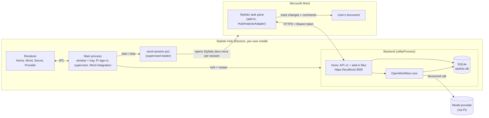
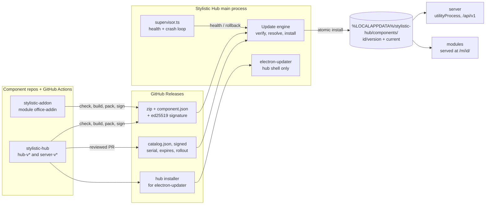
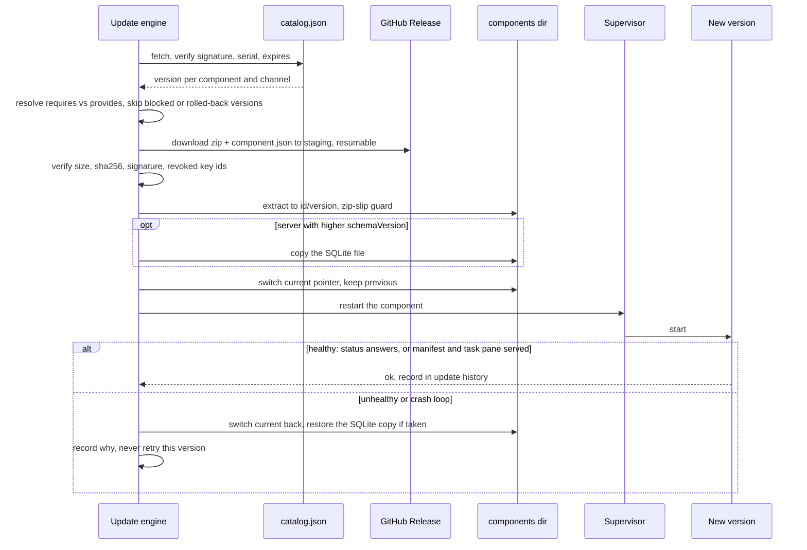

# Architecture

Stylistic is a Word add-in that suggests editorial changes as Word track changes, and the Stylistic Hub is the Windows desktop app that makes it run on one computer: it installs the add-in into Word, serves it, and runs the local backend that analyzes the text with the model provider the user signed in to. This page first describes the product as a whole, then the backend's internal design. Where the next steps are going: [roadmap](roadmap.md).

## System overview



### Components

| Component | Where | What it does |
|---|---|---|
| Main process | `src/main/app.ts` | Owns the window and the tray (closing the window keeps the hub running), the IPC for the screens, and the per-user state under Electron's `userData` (`src/main/hub-paths.ts`: Pi folder, `stylistic.db`, certificates, hub token). |
| Renderer | `src/renderer/` | React + Fluent UI v9 screens: Home (the next undone step), Word add-in, Local server, AI provider. |
| Provider sign-in | `src/main/pi-provider.ts` | Pi owns the provider catalog, OAuth and API-key sign-in, credentials and the chosen model; the hub only sees the `PiProvider` port. The backend reads the same Pi folder. |
| Supervisor | `src/main/supervisor.ts`, `src/main/backend-host.ts` | Forks the backend as an Electron `utilityProcess` and restarts it with backoff; the Word loader reuses it. |
| Backend | `src/backend/entry.ts` | One HTTPS server on `localhost:3000` with a certificate from its own local CA (name-constrained to `localhost`, `127.0.0.1`, `::1`): [API v1](api.md) for the add-in, and the add-in's own files with the hub token written into `taskpane.html` ([add-in contract](addin-contract.md)). Loopback only, Host-header guard, bearer token. |
| Workflows and storage | `src/backend/analysis/`, `feedback/`, `profile/` | Analyses and feedback run as durable OpenWorkflow runs on SQLite, so they survive a hub restart; the API reads its own SQLite read model, not the engine's tables. |
| Word integration | `src/main/word-integration.ts` | Trusts the local CA for the current user (`certutil -user -addstore Root`) and registers the add-in manifest in Word's sideload list (`HKCU\…\Wef\Developer`). |
| Word session loader | `src/main/word-session.ts`, `resources/word/word-session.ps1` | Registering is not enough: Word loads a sideloaded add-in only while it shows a document that refers to it. Once per Word session, after the user opens a document, the loader opens `Stylistic.docx` (the trigger document) through COM, waits for the add-in's UI, closes the trigger and its pane, and gives the user's window back. The trigger is visible for about a second (see the custom-code table below). |
| Add-in | separate repository `stylistic-addon` | The task pane in Word. In hub mode it reads the token from `<meta name="stylistic-hub-token">`, talks to API v1 through `HubAnalysisAdapter`, `HubFeedbackAdapter` and `HubUserCorrectionPreferencesAdapter`, and writes suggestions into the document with Word's track changes and comments. The hub bundles any checkout that meets the [add-in contract](addin-contract.md) (`bun run addin:bundle`). |
| Installer | `electron-builder.yml`, `scripts/stage-prod-addin.ts` | `bun run dist` builds an unsigned per-user NSIS installer. The add-in is packed outside the asar under a production add-in id and the shipped manifest texts from `resources/addin-shell/manifest.json`, so an installed hub never shares Word's sideload entry with development. |

### From "Analizar y sugerir" to track changes

1. **Before:** the user installed the hub, signed in to a provider and chose a model, and turned on Stylistic in Word from the hub; the hub trusted its CA, registered the manifest and started the loader, which loads the add-in into each Word session.
2. **Ready check:** the task pane asks `GET /api/v1/status`; until a model is chosen it shows the hub's `reason` instead of analyzing.
3. **Start:** on "Analizar y sugerir" the add-in splits the selection or document into chunks at paragraph ends and sends `POST /api/v1/documents/{documentId}/analyses` with the genre; `documentId` is the UUID the add-in keeps in the Word document. The hub answers `202`.
4. **Run:** an OpenWorkflow run splits each chunk into parts that fit one model call, analyzes the parts in parallel as child workflows (each a forced structured call through Pi to the chosen provider), drops suggestions whose anchor is not in their context, stores the rest in the read model, and updates the document's style profile once.
5. **Poll:** the add-in polls `GET /api/v1/analyses/{id}` until the analysis is `completed`, `partial`, `failed` or `canceled`; a provider's error arrives in the failed chunk's `error`, not as an HTTP error.
6. **Apply:** the task pane locates each suggestion's anchor in the document and applies it as a track change or a comment, which the user then accepts or rejects.
7. **Learn:** each accept or reject is sent to `POST /api/v1/feedback`, which updates the profile in the background for the next analysis.

The request and response shapes live in [API v1](api.md); what an add-in build must provide lives in the [add-in contract](addin-contract.md).

## Target architecture: component delivery

> **Target, not today's behaviour.** This section describes where delivery is going; the System overview above is what runs today. The decision and its alternatives: [ADR 0001](adr/0001-component-delivery.md). The milestones that build it: [roadmap](roadmap.md).

The hub becomes a launcher: installed once, it installs and updates its components independently, like HoYoPlay does with its games. The hub, the server and every module are versioned, released and updated on their own.



### Current vs target

| Aspect | Today | Target |
|---|---|---|
| What the installer carries | Hub, backend and one add-in build (`bun run dist`) | The hub only (S1) |
| Where the add-in comes from | A sibling checkout built by `bun run addin:bundle` into `resources/addin/` | A signed release of the module's own repo, downloaded by the hub (D2, D5) |
| Where the server comes from | Built into the hub (`src/backend/entry.ts`, forked by `backend-host.ts`) | A signed `server-v*` release under `components/server/<version>/`, forked the same way (D1, D5) |
| Updating the add-in or the server | Rebuild and reinstall the hub | Per component, from the catalog, without touching the hub (D5) |
| Updating the hub | Manual reinstall | electron-updater, channels `stable`/`beta` (D10) |
| Integrity | None beyond the installer itself | ed25519 signatures over `component.json`, signed catalog with `serial` and `expires` (D3, D4) |
| Compatibility | Implicit: whatever was bundled together | `requires`/`provides` ranges resolved before install (D2, D5) |
| Failure of a new version | The supervisor restarts the same backend with backoff | Health check or crash loop rolls back to the previous version (D6) |
| Database across versions | `user_version` migrations; a newer schema makes an older backend refuse to start (`database.ts`) | Expand/contract migrations, copy before a higher `schemaVersion`, restore on rollback (D7) |
| Add-in URL | `https://localhost:3000/` root | `https://localhost:3000/m/<id>/` per module (D8) |
| Word registration | Manifest registered once by `word-integration.ts` | Re-registered only when a module's manifest identity changes (D8) |
| API token | One hub token written into `taskpane.html` | Module-scoped tokens limited to the API scopes the module declares (quality bar) |

### Install, update and rollback



A failure at any step before the pointer switch leaves the installed version untouched; the staging area is discarded or resumed on the next check.

### Design decisions

- **D1 Components.** Three kinds, each its own repo and tags: `hub` (Electron shell, `hub-v*`), `server` (the backend bundle, `server-v*`, run by the hub in its `utilityProcess`), `module` (an `id` and a `kind`; the first kind is `office-addin`, the Word add-in; the kind leaves room for others without designing them now).
- **D2 Release artifact.** Every server and module release publishes a zip plus a `component.json`: `id`, `kind`, `version`, `channel`, `sha256`, `size`, `requires` (a `hub` range and, for modules, the server `api` range such as `^1`), `provides` (for the server: the API versions it serves and its SQLite `schemaVersion`), and a release notes URL. They are GitHub Release assets of the component's own repo.
- **D3 Own signing, no CA.** ed25519 detached signatures over `component.json`, which pins the zip's sha256. The private key lives only in CI secrets; the hub embeds a keyring of public keys with key ids, so keys can rotate; a list of revoked key ids ships in the catalog.
- **D4 Signed catalog (TUF-lite).** The hub repo publishes a signed `catalog.json` listing, per component and channel, the current version and its artifact URLs. A monotonically increasing `serial` and an `expires` date let the hub reject rollback (an older serial) and freeze (an expired catalog) attacks. It has fields for staged rollout (`rolloutPercent`) and for blocking a bad version.
- **D5 Update engine.** In the hub's main process: checks on start and periodically; downloads into staging with resume; verifies size, sha256 and signature; resolves compatibility (the hub range, the server API against each module's required range) and refuses an update set that would break another component; installs atomically into `%LOCALAPPDATA%/stylistic-hub/components/<id>/<version>/` with a `current` pointer; keeps the previous version; never extracts outside its target (zip-slip guard).
- **D6 Health checks and automatic rollback.** After switching a server version the hub waits for `/api/v1/status`; after switching a module it checks that its manifest and task pane are served. A failure, or a crash loop detected by `supervisor.ts`, rolls back to the previous version and records why; the bad version is not retried until a newer one appears.
- **D7 Server data safety.** Migrations are forward-only and expand/contract: a release never drops what the previous release reads. The hub copies the SQLite file before a server version with a higher `schemaVersion` starts; a rollback restores that copy. A downgrade below the database's `schemaVersion` is refused unless a backup exists.
- **D8 Module serving and Word.** Each module is served at `/m/<id>/` on the hub origin, with the versioned asset URLs and `Cache-Control` the hub already applies (`bef61c1`). Word re-registration happens only when a module's manifest identity changes; a new version takes effect on the next task pane open, and the task pane can ask the hub (`/api/v1/modules`) whether a newer version is installed and offer a reload.
- **D9 Channels and rollout.** `stable` (from `main`) and `beta` (from `dev`, prereleases) per component, chosen in the hub UI; staged rollout by hashing a random install id against `rolloutPercent`; a version can be pulled from the catalog.
- **D10 Hub self-update.** electron-updater from the hub's GitHub Releases, unsigned (non-goal S2 a accepted), with the same channels.
- **D11 Library UI.** A HoYoPlay-like library screen: one card per component with installed and available version, channel, progress and release notes, and the actions install, update, repair, uninstall and roll back; the update history is visible; the first run downloads the server and the modules the user picks.
- **D12 Pipeline and contracts.** Each repo's GitHub Actions run `check`, build, pack, sign and publish release assets; the hub repo's catalog changes through a reviewed PR. CI enforces the contracts: the module contract (today's [add-in contract](addin-contract.md), generalized) runs in the module's CI; the API's OpenAPI document is diffed against the last release, and a breaking change fails unless the API major version changes (v1 is additive only; v2 is served alongside). Developer overrides: `--server <dir>`, `--module <id>=<dir>`, a local catalog file, and a dev signing key.

Cross-cutting: fault-injection tests for the update engine, local structured logs with update history and an exportable diagnostics bundle, and module-scoped tokens; see the [world-class bar](roadmap.md#world-class-bar).

Notes (implementation, not decisions): the `current` pointer can be a small file naming the version rather than a directory junction, so switching is one atomic rename; `--module <id>=<dir>` generalizes today's `--addin <dir>` backend flag; the zip library is an existing one (the hub already depends on `adm-zip`), see the ADR's notes on adoption.

## Backend

The Stylistic Hub backend uses **hexagonal architecture (ports and adapters)** with a **feature-first (screaming) folder layout**. It is not full Clean Architecture: the domain is small, so extra layers would add ceremony without benefit.

### Why hexagonal

- The design principle "do not reinvent the wheel" leaves a small domain: prompts, the suggestion schema and its rules, and the style profile. Everything else is an adopted tool.
- Each adopted tool must stay swappable, which is what an adapter behind a port gives us (OpenWorkflow → Mastra in-memory or `pi-durable`; Pi → another model runtime; `node:sqlite` → another store).
- It matches the add-in (whose own `HubAnalysisAdapter` speaks [API v1](api.md), and whose build the hub packages under the [add-in contract](addin-contract.md)) and dhub (`domain/` + `adapters/`), so the monorepo shares one mental model.

### Ports: only where they pay off

Add a port only when a swap is plausible or tests need it. Do not wrap everything.

| Port | Adapter today | Reason |
|---|---|---|
| `LlmPort` (`structuredCall`) | Pi | Tests without network; isolates the forced-tool output |
| `WorkflowEngine` | OpenWorkflow | Plan B is real; the engine only executes, it holds no result the API reads |
| `DocumentRepository` | `node:sqlite` | Documents and their style profiles |
| `AnalysisRepository` | `node:sqlite` | The read model of analyses, chunks and suggestions the API serves, apart from the engine's own tables |
| `FeedbackRepository` | `node:sqlite` | Feedback and what became of it |
| `PiProvider` (`src/main/pi-provider.ts`) | Pi `ModelRuntime` + `SettingsManager` | Pi breaks its API between releases; the IPC layer and the Provider screen only see this interface |

Hono (HTTP) and Electron are the outer driving side and get no port: they are entry points, not something we expect to replace.

### Rules

- Domain code imports no adopted tool (no Pi, OpenWorkflow, Hono or `node:sqlite` imports). zod is the exception: the schemas are domain, copied from stylistics-backend, and ports carry them.
- Adapters depend on ports, never the other way round.
- One adapter per adopted tool; keep it thin (glue, not engines).
- Any new port records its reason in the table above.
- A workflow body never catches what a step throws: OpenWorkflow retries a failed step by replaying the run and pauses a run by throwing. Work whose final failure must be recorded (a part, the profile update, processing feedback) runs as a child workflow, whose failure is final and comes back as a `ChildResult`.
- The profile is written once per analysis and once per feedback, through `profile-updater.ts`, which serializes writes per document so no update is lost.
- Tests that run workflows and services over the real SQLite adapters are named `*.integration.test.ts` and live in their own fallow zone, which may import adapters; rules such as how an analysis settles live in the repository's SQL, and a fake would duplicate them.

### Custom code and why

Per the "do not reinvent the wheel" principle, every piece we wrote ourselves is listed here.

| Code | Why no existing tool |
|---|---|
| `src/backend/adapters/http/host-allowlist.ts` | Hono ships CORS, IP restriction and bearer auth (all used) but no Host-header guard, which DNS rebinding requires. |
| `src/main/supervisor.ts` | No maintained package restarts Electron's `utilityProcess` with backoff; ~50 lines. |
| `src/backend/adapters/sqlite/database.ts` | `node:sqlite` has no migration helper; a `user_version` loop over append-only SQL strings is ~20 lines. Knex/Drizzle/umzug would add a dependency for one table. |
| `src/backend/adapters/http/api-v1.ts` + `problem.ts` | The routes, their validation and `GET /api/v1/openapi.json` come from `@hono/zod-openapi` over the domain's zod schemas; ours is only the route table and the RFC 9457 problem body (~10 lines), which Hono does not ship. |
| `src/backend/profile/profile-updater.ts` | A promise queue per document (~25 lines) so concurrent analyses and feedback never overwrite each other's profile; a lock library would add a dependency for one in-process map. |
| `src/backend/analysis/parts.ts` | Splits a chunk into parts at paragraph ends so a 100k-character chunk fits a model call, and drops suggestions whose anchor is not in their context (~40 lines); text splitters such as LangChain's cut paragraphs and bring a framework. |
| `src/backend/adapters/pi/pi-llm.ts` | Pi has no structured-output call and its neutral `toolChoice` is only `auto`/`none`. The adapter turns the zod schema into a `submit` tool (`z.toJSONSchema`), forces it with each API's own `toolChoice` (10 APIs) and validates with zod. |
| `src/shared/login/` | Not ours: copied from dhub (`src/main/domain/login.ts`, revision `bd94206`) with its tests. Pi exposes login as callbacks; this correlates them with UI prompts. Keep in sync with dhub. |
| `src/backend/adapters/tls/certificates.ts` | Thin use of `@peculiar/x509` to issue a local CA and a localhost leaf; mkcert/devcert need an external binary or admin rights. The CA's name constraints (only `localhost`, `127.0.0.1`, `::1`) are built with `@peculiar/asn1-x509`, which `@peculiar/x509` has no class for. |
| `src/main/word-integration.ts` | `office-addin-dev-settings` writes the same sideload registry value but brings Teams publishing, prompts and usage telemetry; the hub calls Windows' own `certutil -user -addstore Root` and `reg` instead (~60 lines). Registering alone does not make Word load the add-in; see the `word-session` row. |
| `src/main/word-session.ts` + `resources/word/word-session.ps1` | Word reads a sideloaded add-in only while it shows a document that refers to it, and forgets it when Word restarts (measured: a global template in Word's STARTUP folder, the `Wef` flags, a local trusted catalog and an invisible document all fail; see `odd/tasks/mvp.md` L35). No tool loads an add-in into a running Word, so a supervised PowerShell script creates a document from `Stylistic.docx` through Word's COM automation once per Word session, as soon as the user has a document of their own open (never on Word's start screen), closes it unsaved and brings the user's window back. What decides the load is the add-in's own UI in a window of that Word — never a `MsoWorkPane`, which Word creates from the trigger's own `taskpanes.xml` even when the add-in never starts — so a session whose UI does not appear within the wait is reported as not loaded, with the reason (`the trigger's task pane opened, but the add-in's UI is not in the window`; `Word asked the hub for the add-in's page, but the add-in's UI is not in the window`; `Word started nothing`), and tried again after five minutes; a session whose window already shows the UI gets no trigger at all. The trigger document opens the add-in's task pane — that is what loads the add-in — and the script closes that pane through Word's own "Close pane" button (UI Automation) before closing the document, because otherwise Word restores the pane, empty, in the user's documents next session, and it closes any such restored pane it finds. It reaches the user's Word through the window the user sees (the accessibility API's `OBJID_NATIVEOM` on Word's document window) rather than `GetActiveObject`, which returns whichever Word registered first, and a Word without a window is logged and ignored. It logs to `word-session.log` in the hub's logs folder; `Documents.Add` rather than `Open`, because opening would replace an untouched blank document the user just started. The only supported way to have Word install an add-in by itself is `Wef\AutoInstallAddins`, which requires a Microsoft Marketplace listing. Word shows the trigger document in a second window for about a second while the loader opens it, waits and closes it, and nothing hides that window: and that window is what starts the add-in: hiding it stops the load whether the hider runs inside Word (the retired hook) or in the loader's own process (measured, `odd/tasks/mvp.md` L52), so the loader prefers the add-in (user measurement, `odd/tasks/mvp.md` L51). It installs nothing into Word: the `WH_CBT` hook DLL that used to hide the trigger window was measured to be the reason the add-in stopped loading, and is retired (`odd/tasks/mvp.md` L49 and L50). Every mechanism that was tried before this one, and the measurement that discarded it, is recorded in `reports/Cargar Stylistic en Word (postmortem).md`. Restarts reuse `supervisor.ts` (~45 + ~45 lines). |
| `scripts/bundle-addin.ts` + `scripts/addin-bundle-contract.ts` | Enforce the [add-in contract](addin-contract.md): pick `build:hub` or `build`, check that `dist/` has `manifest.xml` with a task pane `SourceLocation` and `taskpane.html` with `</head>`, and stage next to `resources/addin/` so a failed bundle leaves it in place. Pointing the manifest at the hub replaces the task pane's origin with `https://localhost:3000` as a string (~10 lines): no XML library is a dependency, and the add-in's manifest tool (`office-addin-manifest`) validates and changes only the id and display name, not URLs. |
| `Stylistic.docx` step in `scripts/addin-bundle-contract.ts` (`scripts/addin-document.ts`) | The document comes from `office-addin-dev-settings`' own template and placeholders (MIT, in `scripts/templates/`), filled with `adm-zip` as that tool does. Depending on the tool itself would add the Microsoft 365 Agents Toolkit CLI (83 MB, ~950 lockfile lines) for one 12 KB template (~20 lines). |
| `src/backend/adapters/http/addin-routes.ts` | `serveStatic` serves the add-in. Custom: putting the hub token into `taskpane.html` as a meta tag, so the task pane needs no sign-in; adding each local file's modification time to the task pane's `src`/`href` URLs and sending `Cache-Control: no-cache` from a middleware (`serveStatic`'s `onFound` runs after the response is built), because webpack names the files the same in every build and Word's WebView would otherwise run a rebuilt add-in's old scripts (~25 lines). A bundler plugin hashing file names would have to live in each add-in's build, which the hub does not own ([add-in contract](addin-contract.md)). |

### Folder layout

The boundaries are enforced by fallow from the zones in `.dharness/fallow.jsonc`, run by `dharness check` on every commit.

```
src/backend/
  analysis/     # analysis workflows and service: prompts, schemas, parts, suggestion rules
  feedback/     # feedback workflows and service
  profile/      # per-document style profile
  ports/        # LlmPort, WorkflowEngine, repositories, ProviderAuth
  adapters/     # pi/, openworkflow/, sqlite/, http/ (Hono)
```
